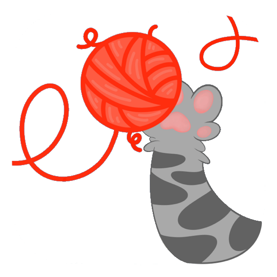
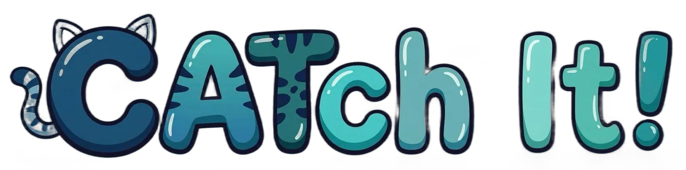

# CATch It! 🐾

<p align="center">
  <strong>Il videogioco interattivo nativo per gatti su iPad e macOS</strong><br>
  Progettato con SwiftUI, animazioni a 60 FPS, interfaccia Liquid Glass nativa e ricerca etologica felina.
</p>

<p align="center">
  <br/>
  
</p>

---

## 📖 Indice
- [Caratteristiche Principali](#-caratteristiche-principali)
- [Ricerca Etologica & Psicologia Felina](#-ricerca-etologica--psicologia-felina)
- [Interfaccia & Modalità di Gioco](#-interfaccia--modalità-di-gioco)
- [Requisiti di Sistema](#-requisiti-di-sistema)
- [Come Scaricare e Avviare il Gioco](#-come-scaricare-e-avviare-il-gioco)
  - [1. Clonare il repository](#1-clonare-il-repository)
  - [2. Apertura ed Esecuzione con Xcode](#2-apertura-ed-esecuzione-con-xcode)
  - [3. Compilazione da Terminale (macOS)](#3-compilazione-da-terminale-macos)
- [Distribuzione su iPad / App Store](#-distribuzione-su-ipad--app-store)
- [Architettura del Progetto](#-architettura-del-progetto)
- [Licenza & Autore](#-licenza--autore)

---

## ✨ Caratteristiche Principali

- 🐾 **Gameplay ottimizzato per felini:** traiettorie periferiche, scatti a zig-zag, pause strategiche (*freezing*) e reazioni di fuga istantanee ai mancati colpi.
- 🎨 **Design Liquid Glass Nativo:** sfondi, pulsanti e pannelli con vera rifrazione ottica Apple (`.glassEffect()`), senza artefatti o barre grigie opache.
- 🎬 **Sprite Animati Frame-by-Frame:** animazioni fluide a 60 FPS per uccellini, topolini e gomitoli di lana.
- 🔊 **Audio Biologico e Riservato:** frequenze sonore stimolanti tra 2.800 Hz e 5.000 Hz (cinguettii, squittii, fruscii di tessuto) con rimozione totale di campanelli metallici o suoni fastidiosi.
- 🔒 **Protezione Antiuscita ("Cat-Proof"):** pulsanti e HUD protetti per evitare tocchi accidentali delle zampe durante le sessioni di gioco più intense.
- ⚙️ **Personalizzazione Totale:** opzioni interattive per regolare velocità, durata della sessione (1, 3, 5, 10 minuti o ∞) e numero di prede simultanee (1, 2, 4, 6, 8).

---

## 🎯 Ricerca Etologica & Psicologia Felina

La progettazione si basa sui principi scientifici della percezione sensoriale e predatoria del gatto:

1. **Sequenza Predatoria (*Orient $\rightarrow$ Stalk $\rightarrow$ Chase $\rightarrow$ Pounce*):**
   - I gatti possiedono una vista dominata dai bastoncelli, ipersensibile al movimento periferico e alle variazioni repentine di velocità.
   - Il movimento lineare continuo perde rapidamente interesse; per questo le prede nel gioco alternano micro-pause di allerta a scatti rapidi verso i bordi.
2. **Reazione di Fuga al Tocco Mancato:**
   - Se una zampata manca la preda entro un raggio di prossimità, la preda reagisce immediatamente fuggendo nella direzione opposta a velocità raddoppiata.
3. **Feedback Immediato alla Zampata:**
   - All'impatto con la zampa: onda d'urto visiva (ripple acquatico), suono attenuato di conferma tattile (*pop*) e dispersione di particelle colorate ad alto contrasto visivo.
4. **Spettro Cromatico Felino:**
   - Visione dicromatica ottimizzata sui toni del blu, ciano, verde e giallo caldo, con contrasti netti rispetto allo sfondo.

---

## 🎮 Interfaccia & Modalità di Gioco

| Modalità | Descrizione |
|---|---|
| 🐦 **Bird** | Uccellino in volo con planate ad arco, sbattiti d'ali e atterraggi improvvisi. |
| 🐭 **Mouse** | Topolino veloce con scatti a zig-zag, pause furtive e scatti verso le tane periferiche. |
| 🧶 **Thread** | Gomitolo di lana con animazione di trascinamento elastico e pause a strattoni. |
| 🎲 **Mix** | Modalità dinamica casuale con tutte le prede alternate per mantenere alta l'attenzione. |

### Pannelli di Controllo (Liquid Glass)
- **Audio:** Regolazione del volume sonoro degli effetti etologici.
- **Game Settings:**
  - **Tempo di Gioco:** `1m`, `3m`, `5m`, `10m` oppure sessione infinita (`∞`).
  - **Numero di Prede:** `1`, `2`, `4`, `6` o `8` prede simultanee a schermo.
  - **Velocità:** Slider con feedback aptico per regolare la reattività delle prede da 0.5x a 2.0x.

---

## 💻 Requisiti di Sistema

- **macOS:** macOS 14.0 (Sonoma) o macOS 15.0 (Sequoia) / macOS 26+
- **iPadOS:** iPadOS 17.0 o successivo
- **Strumenti di sviluppo:** Xcode 16.0 o successivo (Swift 6)

---

## 🚀 Come Scaricare e Avviare il Gioco

### 1. Clonare il repository

Apri il **Terminale** ed esegui:

```bash
git clone https://github.com/AlexFeb-prog/CATch-IT.git
cd CATch-IT
```

### 2. Apertura ed Esecuzione con Xcode

1. Apri il progetto in Xcode:
   ```bash
   open CatChIt.xcodeproj
   ```
2. Nella barra degli schemi in alto a sinistra, seleziona il target:
   - **My Mac** (per provarlo direttamente sul tuo Mac)
   - oppure il tuo **iPad** / un simulatore iPad.
3. Premi **⌘R** (Command + R) o clicca sul pulsante **Play** ▶ per compilare e avviare il gioco.

### 3. Compilazione da Terminale (macOS)

Se desideri generare ed eseguire l'applicazione nativa `.app` direttamente dalla riga di comando:

```bash
# Compilazione Release
xcodebuild -project CatChIt.xcodeproj -scheme CatChIt -sdk macosx -configuration Release -derivedDataPath build build CODE_SIGN_IDENTITY="" CODE_SIGNING_REQUIRED=NO CODE_SIGNING_ALLOWED=NO

# Avvio dell'applicazione
open build/Build/Products/Release/CatChIt.app
```

---

## 📲 Distribuzione su iPad / App Store

Per installare il gioco sul proprio iPad o distribuirlo su TestFlight / App Store:

1. Apri `CatChIt.xcodeproj` in Xcode.
2. Vai su **CatChIt** nel navigatore di progetto $\rightarrow$ tab **Signing & Capabilities**.
3. Seleziona il tuo **Apple Developer Team** e imposta il tuo bundle identifier.
4. Connetti il tuo iPad tramite cavo o Wi-Fi e selezionalo come dispositivo di destinazione.
5. Per pubblicare su App Store Connect:
   - Seleziona **Any iOS Device (arm64)** come destinazione.
   - Vai nel menu **Product $\rightarrow$ Archive**.
   - Clicca su **Distribute App** e segui la procedura guidata di App Store Connect.

---

## 📂 Architettura del Progetto

```text
CATch-IT/
├── CatChIt.xcodeproj/        # Configurazione del progetto Xcode
├── Sources/
│   ├── CatChItApp.swift      # Entry point dell'app SwiftUI
│   ├── ContentView.swift     # Router principale della navigazione
│   ├── HomeView.swift        # Schermata iniziale con Play button e Liquid Glass dock
│   ├── TypeGameView.swift    # Selezione prede (Bird, Mouse, Thread, Mix)
│   ├── SettingsView.swift    # Pannelli opzioni Liquid Glass (Audio & Gioco)
│   ├── GamePlayView.swift    # Motore di gioco a 60 FPS, collisioni, HUD e gestione tap
│   ├── PreySpriteView.swift  # Render e interpolazione dei frame animati delle prede
│   ├── GameplayEntities.swift# Modelli dati delle entità e fisica
│   ├── GameState.swift       # Stato globale reattivo (@Observable)
│   ├── SoundManager.swift    # Riproduttore audio a bassa latenza con AVFoundation
│   └── AssetHelper.swift     # Utility per caricamento sicuro degli asset
├── Assets/                   # Sprite frame-by-frame, campioni sonori .wav e grafiche
└── README.md                 # Documentazione del progetto
```

---

## 📄 Licenza & Autore

Sviluppato da [AlexFeb-prog](https://github.com/AlexFeb-prog).  
Distribuito per uso libero e ricreativo. I contributi tramite Issue e Pull Request sono benvenuti! 🐾
